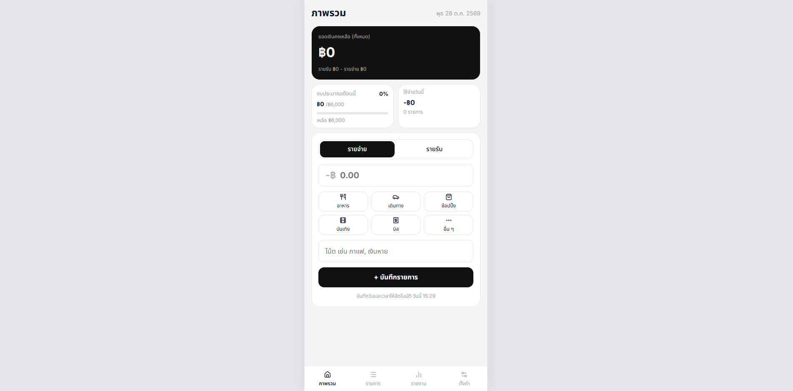
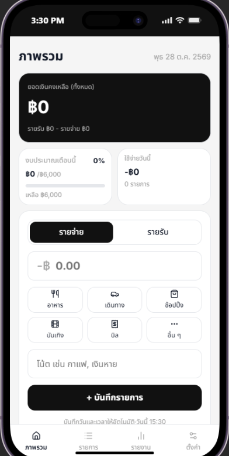

# QSpend V1.0.0 (Quick-Spend) 

เว็บแอปบันทึกรายรับ-รายจ่ายที่ผมสร้างขึ้นมาเพื่อแก้ปัญหาชีวิตตัวเองและฝึกเขียนเว็บแบบจริงจัง ปกติผมชอบจดเงินที่ใช้ไปในแอปโน้ตบนมือถือ แต่พอสิ้นเดือนทีไรขี้เกียจมานั่งกดเครื่องคิดเลขบวกเลขย้อนหลังทุกที ส่วนแอปที่มีให้โหลดทั่วไปก็ชอบมีโฆษณา ต้องสมัครสมาชิก แถมกรอกข้อมูลยุ่งยาก ผมเลยทำเว็บนี้ขึ้นมาเพื่อเน้นเปิดปุ๊บ จดได้ปั๊บใน 3 วินาที สรุปยอดเงินให้เสร็จสรรพ และเก็บข้อมูลไว้ในเครื่องตัวเอง

## Preview

ทดลองใช้งานได้ที่: [Try QSpend](https://quick-spend-six.vercel.app/)
(รองรับทั้งการเปิดบนคอมพิวเตอร์และบนมือถือ หรือจะกด Add to Home Screen เพื่อติดตั้งลงเครื่องก็ได้)
### Desktop View

### Mobile View
<p align="center">
  
</p>

## Features

- Quick-Add Transaction: บันทึกรายรับหรือรายจ่ายได้อย่างรวดเร็ว เพียงระบุจำนวนเงิน เลือกหมวดหมู่ และเพิ่มโน้ตหากต้องการ
- Real-time Summary Cards: ดูยอดคงเหลือ งบประมาณคงเหลือประจำเดือน และยอดใช้จ่ายวันนี้ได้ทันที
- Analytics & Reports: สรุปรายจ่ายรายเดือนด้วยกราฟย้อนหลัง 3 เดือน สัดส่วนตามหมวดหมู่ และค่าเฉลี่ยต่อวันที่มีการใช้จ่าย
- Search & History: ค้นหารายการจากโน้ตหรือหมวดหมู่ และย้อนดูประวัติในแต่ละเดือนได้
- Smart Currency Formatting: แสดงจำนวนเงินทศนิยม 2 ตำแหน่งเฉพาะเมื่อมีเศษสตางค์ เพื่อให้อ่านยอดเงินได้ง่าย
- Dark Mode: สลับระหว่างธีมสว่างและมืด พร้อมบันทึกการตั้งค่าไว้ในเบราว์เซอร์
- Offline PWA: ติดตั้งแอปไว้บนหน้าจอหลักและใช้งานออฟไลน์ได้ หลังจากเคยเปิดใช้งานขณะออนไลน์
- Data Management: ส่งออกข้อมูลสำรองเป็นไฟล์ JSON และนำเข้าข้อมูลเป็นไฟล์ JSON ได้ โหลดข้อมูลตัวอย่าง และล้างข้อมูลทั้งหมดได้จากหน้าตั้งค่า

## Tech Stack

- Frontend: HTML5, CSS3, TypeScript (Vanilla)
- Build Tool: Vite
- Package Manager & Runtime: Bun
- Offline & Storage: Web Storage API (localStorage, sessionStorage) และ Service Worker Cache API
- Deployment: Vercel
- Tools: VS Code, Git
- AI Pair Programming: Gemini, Claude (ใช้เป็นคู่คิดทบทวนแนวคิด ตรวจสอบ Code Smells และร่วมวิเคราะห์แนะนำ)

## Getting Started

ต้องติดตั้ง [Bun](https://bun.sh/) ไว้ในเครื่องก่อน แล้วรันคำสั่งตามนี้ได้เลย:
```bash
# 1. โคลนและติดตั้ง dependencies
git clone https://github.com/kxitta00/expense-tracker.git
cd expense-tracker
bun install
# 2. รันแอปในเครื่อง (เปิดที่ http://localhost:5173)
bun run dev
# 3. บิลด์สำหรับ Production
bun run build
```
## Project Structure

```text
src/
├── data/          # เก็บข้อมูลตัวอย่างเริ่มต้น (Mock Data) สำหรับกดปุ่มทดลองใช้งาน
├── logic/         # ฟังก์ชันคำนวณเงินและสถิติต่างๆ (รวมยอดคงเหลือ, กราฟ 3 เดือน, เฉลี่ยต่อวัน)
├── storage/       # ตัวจัดการบันทึกและอ่านข้อมูลจาก localStorage และ sessionStorage
├── types.ts/      # กำหนด TypeScript types เช่น Transaction และ Category
├── ui/            # โค้ดส่วนวาดหน้าจอ (DOM) ทั้งหมด เช่น การ์ดสรุป, รายการธุรกรรม, หน้ารายงาน, ป็อปอัปต้อนรับ
├── utils/         # ฟังก์ชันช่วยแปลงข้อมูล เช่น แปลงรูปแบบเงิน (Smart Currency) และแปลงวันที่ภาษาไทย
├── constants.ts   # ค่าคงที่ที่ใช้ในระบบ เช่น รายชื่อหมวดหมู่เริ่มต้น (อาหาร, ช้อปปิ้ง, เดินทาง ฯลฯ)
├── main.ts        # ตัวควบคุมหลัก (Controller) คอยดักฟังการคลิกปุ่มต่างๆ และสั่งการทำงานร่วมกัน
└── style.css      # ไฟล์ CSS ทั้งหมดของระบบ รวมถึงตัวแปรสี (Themes) และการจัดหน้าจอ Responsive

public/
├── manifest.json  # ไฟล์ตั้งค่าสำหรับ PWA กำหนดชื่อและไอคอนเวลาติดตั้งลงหน้าจอมือถือ
└── sw.js          # Service Worker ตัวจัดการแคชไฟล์เพื่อให้เปิดแอปใช้งานแบบออฟไลน์ได้

```

## Data & Privacy

ข้อมูลทั้งหมดที่คุณจดจะถูกบันทึกไว้ในเบราว์เซอร์ของคุณผ่าน localStorage ในเครื่องเท่านั้น คุณสามารถสำรองข้อมูลเป็นไฟล์ JSON เก็บไว้ในเครื่องตัวเองได้ตลอดเวลาจากหน้าตั้งค่า

## Challenges & Learnings

โปรเจกต์นี้เป็นโปรเจกต์ใหญ่ชิ้นสุดท้ายที่ผมตั้งใจทำด้วย Vanilla TypeScript และ HTML/CSS โดยไม่ใช้ Framework เพื่อฝึกพื้นฐาน Web Fundamentals ให้แน่น ก่อนจะไปเรียนรู้เทคโนโลยี Framework เช่น React และ Tailwind CSS เพื่อต่อยอดทักษะการพัฒนาเว็บและเตรียมความพร้อมสู่การทำงานจริงในอนาคต

ตลอดระยะเวลา 6–7 วัน หรือประมาณ 40–50 ชั่วโมง ผมได้ฝึกวางโครงสร้างโปรเจกต์ แยกหน้าที่ของโค้ดออกเป็น `logic`, `ui`, `storage`, `utils`, `types` และ `main` ทำให้โค้ดเป็นระเบียบและแก้ไขต่อได้ง่ายขึ้น นอกจากนี้ยังได้ฝึกใช้ AI เป็นคู่คิดและผู้ช่วยรีวิวโค้ด เพื่อช่วยตั้งคำถาม วิเคราะห์จุดที่อาจเกิดปัญหา และเสนอแนวทางที่ดีขึ้น

ระหว่างพัฒนา ผมได้ทดลองใช้งานแอปด้วยตัวเองอย่างต่อเนื่อง ทำให้เจอบั๊กและได้เรียนรู้การแก้ปัญหาจริงหลายเรื่อง เช่น

1. **Date Rollover & Boundaries**  
   เวลากดเลื่อนเดือนในวันที่ 29, 30 หรือ 31 วันที่อาจเพี้ยนหรือข้ามเดือนได้ ผมจึงเรียนรู้ว่าควรกำหนดวันให้เป็นวันที่ 1 ก่อนเปลี่ยนเดือน เพื่อให้การเลื่อนเดือนทำงานได้ถูกต้องเสมอ

2. **Case-Insensitive Search**  
   ตอนแรกการค้นหาต้องพิมพ์ให้ตรงกับข้อมูลทุกตัวอักษรจึงจะเจอ ผมแก้โดยใช้ `.includes()` ร่วมกับ `.toLowerCase()` ทั้งคำค้นหาและข้อมูล ทำให้ค้นหาจากโน้ตหรือชื่อหมวดหมู่ได้ยืดหยุ่นขึ้น

3. **Event Delegation**  
   หลังจาก render รายการใหม่ ปุ่มลบของรายการที่เพิ่งสร้างไม่ทำงาน เพราะ event listener ผูกอยู่กับปุ่มเดิม ผมจึงเปลี่ยนมาให้ container หลักดักจับ event แล้วตรวจสอบว่าผู้ใช้กดปุ่มลบหรือไม่ วิธีนี้ทำให้ปุ่มที่ถูกสร้างใหม่ใช้งานได้โดยไม่ต้องผูก event ซ้ำ

4. **Flexbox Text Truncation**  
   เมื่อผู้ใช้พิมพ์โน้ตยาว ข้อความอาจดันปุ่มลบจนล้นหน้าจอ ผมแก้ด้วย `min-width: 0` ร่วมกับ `text-overflow: ellipsis` เพื่อให้ข้อความตัดเป็นจุดไข่ปลาแทน และรักษา layout บนหน้าจอมือถือ

5. **Active Spending Days**  
   ตอนแรกผมคำนวณค่าใช้จ่ายเฉลี่ยต่อวันโดยหารยอดใช้จ่ายด้วยวันที่ปัจจุบันของเดือน ซึ่งอาจทำให้ค่าเฉลี่ยต่ำเกินจริงสำหรับผู้ใช้ที่เพิ่งเริ่มบันทึกข้อมูลภายหลัง ผมจึงเปลี่ยนเป็นนับเฉพาะวันที่มีรายจ่ายจริง โดยใช้ `Set` กรองวันที่ซ้ำ แล้วนำจำนวนวันนั้นมาใช้เป็นตัวหาร
--

